<div align="center">
  
</div>

<p align="center">
  
  
  
  
  
</p>

---

## 👨‍💻 About Me

```yaml
name      : "Mostafa Shazly"
location  : "Egypt"
education : "Computer & AI Engineering, Year 4"
focus     : "Machine Learning & Deep Learning"
learning  : "Neural Networks · Computer Vision · NLP · Agentic AI"
goal      : "Build things that actually matter"
fun_fact  : "I debug faster after coffee ☕"
open_to_collaborations : true
currently_building     : "ML Models"
```

## 🎯 Currently

- 🔭 Working on **large-scale data pipelines** (590K – 2M+ records)
- 🧠 Deep-diving into **Deep Learning**: CNNs and feature engineering
- 📖 Exploring **Computer Vision**, **NLP** and **Agentic AI** (LLM agents with tool use) next
- 💡 Working toward my first **open source contribution**
- 🏆 Goal 2026: land my first **ML internship**

---

## 🚀 Project Highlights

> Real projects with measured results.

| Project | What I Built | Stack | Key Result |
|---|---|---|---|
| 🌾 [Crop Yield Prediction](https://github.com/mostafashazly7/crop-yield-prediction-ml) | 6-model regression pipeline on 28K+ records across 101 countries | Python · Scikit-Learn | **R² = 98.5%** (KNN) · **CV R² = 98.0%** |
| 🛡️ [IEEE-CIS Fraud Pipeline](https://github.com/mostafashazly7/fraud-detection-feature-engineering-pipeline) | Feature engineering on 590K+ transactions, 433 features, dual-notebook pipeline | Python · Pandas · NumPy | **60% memory reduction** |
| 💹 [Financial Fraud Preprocessing](https://github.com/mostafashazly7/financial-fraud-preprocessing) | End-to-end preprocessing on 2M+ transaction records (Git LFS) | Python · Pandas · Git LFS | **2,000,000+ records** |
| 😷 [Face Mask Detection](https://github.com/mostafashazly7/face-mask-detection) | Custom CNN trained on 7,553 images, binary classification | Python · TensorFlow / Keras | **Test Accuracy = 91.7%** |

---

## 🛠️ Tech Stack

<div align="center">
  
</div>

<div align="center">

| Skill | Level | Used In |
|---|---|---|
| Python | ████████░░ Advanced | All projects |
| Pandas / NumPy | ████████░░ Advanced | All data projects |
| Data Preprocessing | ████████░░ Advanced | 2M+ record pipeline |
| Scikit-Learn | ███████░░░ Intermediate | Crop Yield, Fraud pipelines |
| TensorFlow / Keras | ██████░░░░ Intermediate | Face Mask CNN |

</div>

---

## 🗺️ Roadmap

- [x] Data pipelines on 2M+ records
- [x] Multi-model regression comparison (6 algorithms)
- [x] CNN image classification
- [ ] NLP project
- [ ] Computer Vision project with transfer learning
- [ ] Agentic AI project (LLM agent with tool use)
- [ ] First open source contribution
- [ ] First ML internship

---

## ⚡ By The Numbers

<div align="center">


<br/>


</div>

---

## 📊 GitHub Activity

<div align="center">
  
</div>

<br/>

<picture>
  <source media="(prefers-color-scheme: dark)" srcset="https://raw.githubusercontent.com/mostafashazly7/mostafashazly7/output/github-contribution-grid-snake-dark.svg"/>
  <source media="(prefers-color-scheme: light)" srcset="https://raw.githubusercontent.com/mostafashazly7/mostafashazly7/output/github-contribution-grid-snake.svg"/>
  
</picture>

---

## 🤝 Let's Connect

<div align="center">
  <a href="https://www.linkedin.com/in/mostafa-shazly-148945314/"></a>
  <a href="mailto:mostafashazly461@gmail.com"></a>
  <a href="https://github.com/mostafashazly7"></a>
</div>

<br/>

<div align="center">
  <i>"The best way to predict the future is to build it." — Alan Kay</i>
</div>


